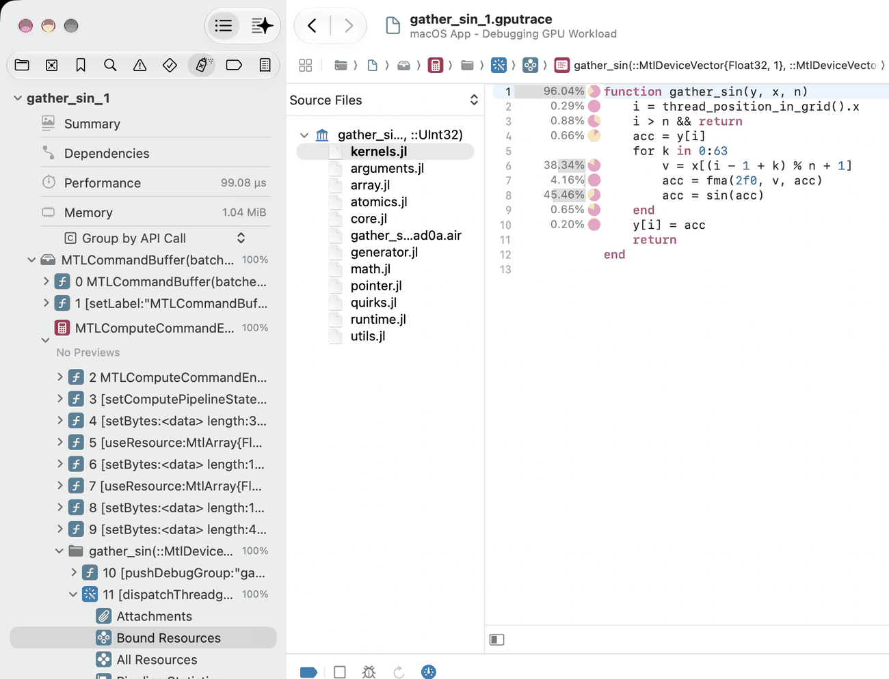
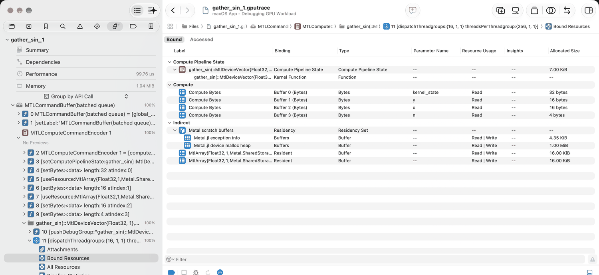
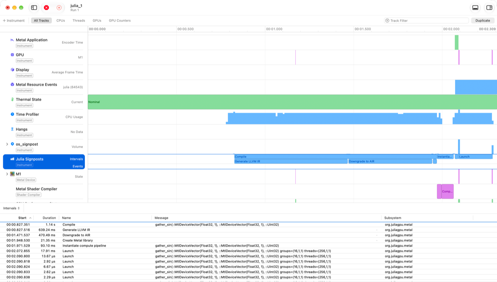

# Debugging and profiling with Xcode and Instruments

Apple's developer tools can show a lot about Julia GPU code: which line of a kernel takes the
time, what the GPU and the CPU do over the course of a program, and which buffers a kernel
was given. This page shows how to get there with Metal.jl, starting from a kernel in a file.

Two of Apple's tools are useful, both part of Xcode:

- **Xcode** opens *GPU frame captures*: recordings of a piece of GPU work, made with
  `Metal.@capture`, that Xcode can replay. It shows every command and its resources, and can
  profile the captured kernels down to individual lines of their source code.
- **Instruments** records a *timeline* of a whole program, or of a block of code with
  `Metal.@profile external=true`: when command buffers run on the GPU, what the CPU does in
  the meantime, and when Metal.jl compiles, launches and waits for kernels.

Metal.jl's integrated profiler (see [Profiling](@ref)) needs neither, and is the quickest way
to find out which kernel is slow; [Choosing a tool](@ref) compares the three.

You need macOS with the full Xcode installed, not only the Command Line Tools. To replay and
profile a capture, you need the Mac that recorded it, or at least one with the same kind of
GPU. This page was written with Xcode 27; buttons and menus may differ in other versions.


## Quick start: a per-line profile of a kernel

This section takes a kernel from Julia code to a profile in Xcode that shows, for every line
of the kernel, its share of the kernel's GPU time.

**1. Put the kernel in a file.** Xcode can only show source code that exists on disk, so
kernels typed at the REPL won't do. Save the following as `kernels.jl` in your project's
directory:

```julia
function gather_sin(y, x, n)
    i = thread_position_in_grid().x
    i > n && return
    acc = y[i]
    for k in 0:63
        v = x[(i - 1 + k) % n + 1]
        acc = fma(2f0, v, acc)
        acc = sin(acc)
    end
    y[i] = acc
    return
end
```

**2. Start Julia with frame capture enabled.** Metal only allows frame capture if the
`METAL_CAPTURE_ENABLED` environment variable is set when the process starts; setting it
from within Julia is too late.

```
$ METAL_CAPTURE_ENABLED=1 julia --project
```

**3. Capture a launch of the kernel.** Wrap the launch in `Metal.@capture`:

```julia
julia> using Metal

julia> include("kernels.jl");

julia> N = 4096; x = MtlArray(rand(Float32, N)); y = MtlArray(rand(Float32, N));

julia> Metal.@capture @metal threads=256 groups=cld(N, 256) gather_sin(y, x, UInt32(N))
[ Info: GPU frame capture saved to /Users/me/project/gather_sin_1.gputrace; open the resulting trace in Xcode
"/Users/me/project/gather_sin_1.gputrace"
```

The trace is saved in the current directory, and named after the kernel.

**4. Open the trace in Xcode, and replay it with profiling.** Open the trace from a terminal
with `open gather_sin_1.gputrace`, by double-clicking it in Finder, or by passing `open=true`
to `Metal.@capture`. Xcode shows the date and the machine of the capture, a *Replay* button,
and above it a *Profile after replay* checkbox. Check it, and click *Replay*. Xcode runs the
captured commands on the GPU again, a few times over while measuring, which takes up to a
minute. Afterwards, its *Summary* page shows the GPU time, and the navigator on the left
lists the captured commands.

**5. Open the kernel's source.** In the navigator, expand the command buffer and then the
compute encoder. Each kernel launch is a folder named after the kernel's Julia signature,
`gather_sin(::MtlDeviceVector{Float32, 1}, ...)`. Expand it, then expand the
`dispatchThreadgroups` call inside it, and select *Bound Resources*. In the table, under
*Compute Pipeline State*, double-click the row of type *Function*. The editor now shows
`kernels.jl`, with each line's share of the kernel's GPU time next to it:



Here, the gather load on line 6 and the `sin` on line 8 take most of the time. The
percentage on the `function` line is the total of the whole kernel, not a hot spot. The
small pie chart next to each percentage breaks the line's time down by the kind of work
(hover it for details).

If you replayed without *Profile after replay*, profile now: click the *Profile GPU trace*
button (a gauge, in the bar between the editor and the debug area at the bottom of the
window) and then *Profile*.

That is all it takes. The rest of this page explains what else a capture shows, how to
record timelines with Instruments, and what to do when something doesn't work.


## Frame capture in detail

### Enabling capture

`METAL_CAPTURE_ENABLED=1` has to be in the environment when Julia starts. Without it,
`Metal.@capture` fails with an error saying so. Besides allowing captures, the variable makes
Metal.jl add information to the objects it creates in that session, so that captures are
easier to read:

- **Labels.** Buffers backing an `MtlArray` are labelled with the array's type and size, e.g.,
  `MtlArray{Float32,1,Metal.SharedStorage}(dims=(4096,))`, and command buffers with where
  they come from, e.g. `MTLCommandBuffer(batched queue)`.
- **Debug groups.** Every kernel launch is wrapped in a debug group named after the kernel.
  Metal.jl batches many kernel launches into one command buffer and compute encoder; the
  debug groups tell them apart.
- **Sources.** Metal.jl embeds the Julia source files of each kernel in the Metal library it
  loads, which is what lets Xcode show them. This costs a few milliseconds per kernel when it
  is first loaded, and makes its library a few tens of kilobytes larger. Kernels are not
  recompiled for it.

Kernels are always labelled with their Julia signature, and Metal.jl's internal buffers
with their purpose (e.g., `Metal.jl exception info`), with or without capture. The
generated function itself is named after the Julia function (`gather_sin`), the same for
every specialization of the kernel, unless `@metal name=...` names it.

Two preferences, set with Preferences.jl or in `LocalPreferences.toml`, override these
defaults. `label_resources` controls the labels of arrays and command buffers and the debug
groups; running Julia with `-g2` also enables them. `embed_sources` controls embedding the
sources. For example, to embed sources even without capture enabled:

```julia
julia> using Preferences, Metal

julia> set_preferences!(Metal, "embed_sources" => true)   # takes effect after a restart
```

### Recording a capture

`Metal.@capture` records all GPU work that the given expression submits to Metal.jl's
command queue, and waits for it to finish:

```julia
julia> Metal.@capture name="step" begin
           x .= x .* 2
           @metal threads=256 groups=cld(N, 256) gather_sin(y, x, UInt32(N))
       end
```

It saves the trace in the current directory as `NAME_N.gputrace`. The name is that of the
kernel launched with `@metal`, or of the function called, and `julia` for anything else
(like the block above, had it not set `name`). `N` is the first number that doesn't
overwrite an existing trace. `Metal.@capture` returns the path of the trace. Its keyword
arguments are:

- `name`: the base name of the trace;
- `open=true`: open the trace in Xcode when the capture finishes;
- `object`: what to capture: a device, a command queue, or a capture scope. The default, the
  global command queue, is where Metal.jl submits the work of the current task;
- `dest`: `MTL.MTLCaptureDestinationGPUTraceDocument` to save a trace (the default), or
  `MTL.MTLCaptureDestinationDeveloperTools` to send the capture straight to Xcode, which only
  works when Julia was started from Xcode.

Kernels that have not been compiled yet are compiled inside the capture. That does no harm:
compilation happens on the CPU and does not show up in the trace.

A trace contains every Metal library and pipeline the process has created so far, not only
those of the captured code. Xcode lists the others as unused resources, but they make the
trace larger. For a clean trace, capture in a fresh Julia session that runs only what you
want to look at. A trace also contains the contents of the buffers that the captured code
uses: large arrays make for large traces, and a trace holds your data, so keep that in mind
when sharing one.

### Finding your way around a capture

After replaying, the navigator on the left lists what the captured code submitted:



- One or more command buffers, labelled `MTLCommandBuffer(batched queue)`. Metal.jl
  batches up to 32 kernel launches into one.
- Inside, a compute encoder. It holds `setComputePipelineState` (which kernel to run),
  `setBytes` (the kernel's arguments), `useResource` (the arrays the kernel uses, by their
  labels), and a folder (debug group) for each kernel launch, named after the kernel.
- In each folder, the `dispatchThreadgroups` call that launches the kernel, with its launch
  configuration (`{16, 1, 1}` groups of `{256, 1, 1}` threads). Expand it to see:
  - *Bound Resources*: the kernel's pipeline and function (labelled with the Julia
    signature), its arguments, and the buffers it can access. The *Parameter Name* column
    names the arguments after the kernel's own arguments (`y`, `x`, `n`), plus
    `kernel_state`, which Metal.jl passes to every kernel. Since Metal does not allow
    labelling arguments, they are called *Compute Bytes*.
  - *All Resources*: every buffer, library and pipeline in the trace;
  - *Pipeline Statistics*: instruction counts and other statistics of the compiled kernel;
  - *Performance* (after profiling): the kernel's GPU time, occupancy, and hardware
    counters.

Double-click a row in *Bound Resources* to see its contents. Arguments are decoded as
structs: an array argument such as `y` shows its device pointer and its `shape` (4096 here),
a scalar like `n` its value. Array buffers show their elements, as `float4` vectors by
default; change the format at the bottom of the view, e.g., to `float` for a
`Vector{Float32}`. The contents are those at the start of the captured work.

### Source code and per-line costs

Double-clicking the kernel's function in *Bound Resources* opens its source. To the left of
the editor, a list titled *Source Files* shows every file that Metal.jl embedded for the
kernel: the file that defines it, Metal.jl's own device code (`array.jl`, `math.jl`, ...),
files of other packages the kernel calls into, and a `.air` file with the compiled kernel (a
binary file, not meant to be read). Click a file to view it.

After profiling, every line that ran shows a percentage of the kernel's GPU time. Some
things to keep in mind when reading them:

- Code that the compiler inlined into the kernel, which includes most of Base and Metal.jl,
  is attributed to the line of the kernel that called it: the cost of `sin` shows up on the
  `acc = sin(acc)` line.
- Functions that are not inlined (e.g., `@noinline` helpers) have their own costs in their
  own file. The line that calls them only shows the cost of the call.
- Metal.jl's files show percentages too, but some of them land on lines that are not code
  (such as a comment): these are inlined functions whose location is recorded imprecisely.
  Read per-line costs in the kernel's own file.
- The popup above the file list switches to a *Call Stack* view: a tree of the kernel and
  the functions it called, with their share of the time. Selecting a function opens its
  source. Xcode names every function in this tree after the kernel (`gather_sin`), also
  the functions it inlined, so expect to click through them. To
  break the time down into inlined functions, Xcode recompiles the kernel's embedded AIR
  with Apple's Metal toolchain; if the tree only shows the kernel itself, check that the
  toolchain is installed (`xcodebuild -downloadComponent MetalToolchain`).

Xcode can only profile one trace at a time; with several traces open, it may report "no
profiling data found".


## Timeline profiling with Instruments

Instruments records what happens over time: when command buffers run on the GPU, what each
CPU thread does, and when Metal.jl compiles, launches and waits for kernels. That makes it
the tool to find idle GPU time, compilation stalls, or CPU overhead between kernels. It needs
no environment variable.

!!! warning
    Instruments traces store the environment variables of the recorded process, which may
    include API tokens and other secrets. Before sharing a trace, check what it contains
    (`xcrun xctrace export --input NAME.trace --toc` prints it), or record a process that
    was started with a minimal environment, e.g. `env -i HOME=$HOME PATH=$PATH julia ...`.

### Recording from Julia

`Metal.@profile external=true` records the given code with Instruments' *Metal System Trace*
template, by starting `xctrace` (Instruments' command-line tool) on the running Julia
process. Continuing with `kernels.jl` from the quick start (in a session with or without
`METAL_CAPTURE_ENABLED`):

```julia
julia> Metal.@profile external=true begin
           for i in 1:100
               @metal threads=256 groups=cld(N, 256) gather_sin(y, x, UInt32(N))
           end
       end
[ Info: System trace saved to /Users/me/project/julia_1.trace; open the resulting trace in Instruments
"/Users/me/project/julia_1.trace"
```

Open the trace with `open julia_1.trace`, or pass `open=true`. Like `Metal.@capture`, it
takes a `name` for the trace. `template` selects another Instruments template (`xcrun
xctrace list templates` lists them). Starting and stopping `xctrace` takes several seconds,
so use it on a block that does a sizeable amount of work. If the block compiles kernels, the
compilation is part of the recording. The screenshot below was recorded in a fresh session,
so it shows `gather_sin` being compiled; in the quick start's session, where the kernel is
already compiled, the recording only shows the launches. To look at the steady state, run
the code once before recording it.

### Recording a script

To record a whole script, including package loading and compilation, run Julia under
`xctrace`. For example, with this `script.jl` next to `kernels.jl`:

```julia
using Metal
include("kernels.jl")
N = 4096; x = MtlArray(rand(Float32, N)); y = MtlArray(rand(Float32, N))
for i in 1:100
    @metal threads=256 groups=cld(N, 256) gather_sin(y, x, UInt32(N))
end
synchronize()
```

record it with:

```
$ julia --project -e 'using Metal; Metal.OS.instruments_package(["org.juliagpu.metal"]; dir=".")'
$ xcrun xctrace record --template 'Metal System Trace' \
      --package Julia.instrdst --instrument 'Julia Signposts' \
      --output script.trace --launch -- $(which julia) --project script.jl
$ open script.trace
```

The first line builds an Instruments package, `Julia.instrdst` in the current directory
(next to its source, `Julia.instrpkg`), with a *Julia Signposts* instrument that records
Metal.jl's signposts (subsystem `org.juliagpu.metal`, see below) and makes Metal.jl emit
them. Without the `--package` and `--instrument` options, the trace has no signposts of
Metal.jl. `xctrace` needs the full path of the executable, hence `$(which julia)`. To
record a session that is already running, replace `--launch -- ...` by `--attach PID`
(`getpid()` in Julia gives the PID), and stop the recording with Ctrl-C.

### Reading the timeline

When Instruments opens a trace, the timeline may be zoomed out far beyond the recording;
choose *View > Zoom > Zoom to Fit*. Metal.jl's signposts are on the *Julia Signposts*
track. Select the track to list its intervals, with their messages, in the detail area at
the bottom, as in this screenshot:



This recording, of the `Metal.@profile external=true` example above, shows from top to
bottom, among others:

- **Metal Application**: when the process encoded and committed command buffers.
- **GPU**: when command buffers ran on the GPU. Metal.jl batches kernel launches, so an
  interval here is a batch of up to 32 kernels, not a single kernel. With labels enabled
  (see [Enabling capture](@ref)), they are called `MTLCommandBuffer(batched queue)`,
  otherwise `Command Buffer 0`, `1`, ...
- **Time Profiler**: CPU usage of the process. Select a time range to list the hottest
  Julia functions in it in the detail area at the bottom. Here, the CPU is busy compiling
  the kernel for most of the recording.
- **os_signpost**: all signposts in the system. Expand it, then its `org.juliagpu.metal`
  subsystem, to see Metal.jl's signposts again, split by category. Only recordings of
  `Metal.@profile external=true`, or with `--instrument os_signpost`, have this track.
- **Julia Signposts**: Metal.jl's signposts. They come in two categories, which the
  *os_signpost* track shows separately:
  - *Compiler*: a **Compile** interval for every kernel compilation, with the kernel's Julia
    signature, containing *Generate LLVM IR*, *Downgrade to AIR* and *Create Metal
    library*; and **Instantiate compute pipeline** when a compiled kernel is loaded onto the
    GPU, also for kernels compiled earlier (e.g., during precompilation).
  - *DynamicTracing*: a **Launch** interval for every kernel launch, with the kernel's
    signature, `groups` and `threads`. It covers the CPU's work to submit the kernel, not
    the kernel's execution, which shows on the *GPU* track. And **Wait for GPU** when a task waits for the GPU to
    finish (`synchronize`, or copying an array to the CPU), but only if the GPU was not done
    yet.

  An interval whose end message is `error` failed. The menu at the top left of the detail
  area switches between the list of intervals, the list of events, and a summary of the
  intervals by name.
- **Metal Shader Compiler**: when Apple's compiler turned the kernel into
  GPU code.

Instruments names kernels after their Julia function, e.g., `gather_sin`, the same for
every specialization of a kernel. Metal.jl's Launch signposts and the pipeline labels give
the full Julia signature. Instruments records the whole system, so some tracks also show
the GPU work of other processes. That includes the *Julia Signposts* track: it shows the
signposts of every Julia process that uses Metal.jl during the recording, without telling
them apart, so stop other such sessions (e.g., test runs) before recording. In a recording
of a script, the script's own intervals come last, after Julia has loaded Metal.jl.

### Adding your own signposts

To mark phases of your own code in the timeline, add signposts with ObjectiveC.jl, much like
NVTX ranges in CUDA.jl:

```julia
julia> using ObjectiveC, .OS   # add ObjectiveC.jl to your environment first

julia> Metal.@profile external=true open=true begin
           @signpost_interval "Time step" begin
               @metal threads=256 groups=cld(N, 256) gather_sin(y, x, UInt32(N))
               @signpost_event "Checkpoint"
               synchronize()
           end
       end
```

They need the *os_signpost* instrument in the recording, which `Metal.@profile
external=true` includes (add `--instrument os_signpost` to the `xctrace` command above), and
show up in the *os_signpost* track next to Metal.jl's. Instruments only shows the name of a signpost if it
is a string literal in a package (code that is precompiled). Signposts from the REPL or a
script are all called `Julia`, with their name in the message (`Time step: start`, `Time
step: stop`, `Checkpoint`), and are listed under an uninformative subsystem name.

Signposts on the default logger are emitted even when nothing is recording, which costs a
little. For signposts on hot code paths, create a logger with
`OSLog("com.example.MyPackage", OS.CATEGORY_DYNAMIC_TRACING)`: its signposts are only
emitted while an instrument asks for them. Build an instrument for both with
`OS.instruments_package(["org.juliagpu.metal", "com.example.MyPackage"]; dir=".")`, and pass
it to `xctrace` as above. See the docstrings of `@signpost_interval` and `@signpost_event` for more,
e.g., how to add a message to a signpost.

### Exporting data

`xctrace export` turns a trace into XML, for use in scripts:

```
$ xcrun xctrace export --input script.trace --toc
$ xcrun xctrace export --input script.trace \
      --xpath '/trace-toc/run[@number="1"]/data/table[@schema="os-signpost"]'
```

The table of contents lists the tables in the trace. Useful ones are `metal-gpu-intervals`
(GPU work), `julia-signpost-interval` (Metal.jl's signposts, as on the *Julia Signposts*
track), `os-signpost` (all signposts) and `time-profile` (CPU samples).


## Choosing a tool

| Question | Tool |
|:---|:---|
| Which operation takes the GPU time? How often is it called, and how much CPU time goes to Metal API calls? | [`Metal.@profile`](@ref) (integrated profiler) |
| Is the GPU idle at times? Where does the CPU time go between kernels? When are kernels compiled? | Instruments: `Metal.@profile external=true`, or `xctrace` |
| Which lines of this kernel are slow? Which buffers and arguments does it get, with which launch configuration? | Xcode: [`Metal.@capture`](@ref) |

A good order is: the integrated profiler first, as it is quick and names the operations
that take the most time; Instruments when the problem lies in the timeline (gaps, stalls,
overhead); and a frame capture to dig into one kernel. The integrated profiler only sees
work that Metal.jl submits itself; Instruments and frame captures also show work submitted
by Metal Performance Shaders and MPSGraph (e.g., matrix multiplications).


## Limitations

- **No stepping through kernels.** Xcode's shader debugger recompiles shaders from Metal
  Shading Language source, which Julia kernels don't have. Debugging a dispatch, inspecting
  variables, and editing and reloading shaders in Xcode are therefore not supported. Only
  line information is recorded.
- Xcode highlights Julia code as if it were Metal Shading Language.
- Only files on disk are embedded: kernels defined at the REPL show no source, and neither
  do functions of Julia's `Base` (whose costs show on the calling line).
- Running Julia with `-g0` removes the line information, and with it the sources and per-line
  costs.
- Source files are read when a kernel is first loaded. If a file changed after the kernel was
  compiled (e.g., when using Revise), the lines Xcode shows may not match the code that ran.
- The call stack in Xcode names functions inlined into a kernel after the kernel.


## Troubleshooting

**"GPU frame capture is not enabled"**: restart Julia with `METAL_CAPTURE_ENABLED=1` in the
environment. Setting `ENV["METAL_CAPTURE_ENABLED"]` within Julia has no effect.

**"Shader source not found" in Xcode**, when opening a kernel's function: the kernel's
library has no embedded sources, or doesn't contain the kernel's file. Check that:

- capture was enabled when the kernel was first launched in the session (or the
  `embed_sources` preference is `true`), and the preference is not set to `false`;
- the kernel is defined in a file, not at the REPL;
- Julia did not run with `-g0`;
- the kernel's file is smaller than 1 MiB: Metal.jl leaves out larger files.

The *Import Sources* button of the alert opens a dialog that lists the libraries in the
trace: a library with embedded sources is marked `Archived`, one without `No Source`.

**Xcode shows binary garbage, or another file than the kernel's**: Xcode didn't find the
kernel's file in the archive, and opened the `.air` file or another embedded file instead.
Click the kernel's file in the *Source Files* list.

**No percentages next to the source**: the trace was replayed without profiling; click the
*Profile GPU trace* button, then *Profile*.

**"no profiling data found"**: close other traces and profile one trace at a time, on the
machine that recorded it.

**"Capture manager is already capturing"**: an earlier capture did not finish, e.g. because
it was interrupted. Restart Julia.

**"Logging is not supported while GPU frame capturing"**: kernels that print (`@mtlprintf`
and friends) can't be launched during a capture.

**"xctrace is not available"**: install Xcode and select it with `xcode-select`.

**"xctrace failed to start recording"**: `xctrace` exited before it started recording, e.g.
because of an unknown template name. Run the `xctrace record` command from
[Recording a script](@ref) by hand to see its output.

**Metal.jl's signposts are missing from an Instruments trace**: the recording lacks the
*Julia Signposts* instrument (see [Recording a script](@ref)).


## API

```@docs
Metal.@capture
```
